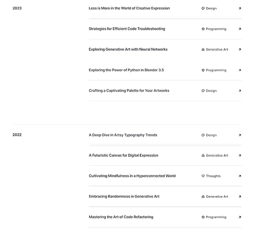

# 文章页面

本文说明[功能规格](./spec/README.md)中的页面规则。

Home、Blogs、文章详情和新增页面共用 `BaseLayout` 的内容容器，以首页文章列表为宽度与水平对齐基准；窄屏随可用空间缩小。

## 详情页

首版包含标题、发布时间、正文、文章目录，以及图片、代码块和表格的阅读样式。

文章日期来自 Notion 的 `Published` 属性，详情页只展示文章日期，不展示更新时间。日期展示及年份统一按北京时间处理。

首版阅读普通文章，支持图片、代码块、表格与引用。Notion 提示框转为引用，并排栏按顺序转为单栏，保留文字顺序及基本结构。

首版不增加音视频或 PDF 播放器、公式及复杂嵌入渲染。遇到范围外或无法完整转换的内容时，报告文章和内容类型，整次同步失败并保留旧站点，不静默删减正文。

子页面不展开，已同步文章的链接转为博客地址，其余保留源链接。空正文保留标题与属性并清空旧正文，详见[发布边界](./ARTICLE_PUBLISHING.md)。

## 全部文章

增加全部文章页面，提供所有已发布博客文章的浏览入口。Header 中 `Home` 与 `Blogs` 导航居中，分别进入首页与全部文章页面；GitHub 图标位于右侧。

按年份分组，年份从新到旧排列，同一年内按文章日期倒序排列。参考用户提供的归档截图：桌面端左侧显示年份，右侧逐行显示文章标题、分类与进入详情页的箭头，文章行之间有细分隔线，年份组之间留出较大间距。

全部文章直接在该页面展示，首版不分页，不增加分类筛选或搜索。列表行不展示摘要；移动端将年份放在该组文章上方，保持标题清晰可读。

首页继续展示最新五篇文章。

文章分类来自 Notion 的 `category` 属性；空值显示为“未分组”。摘要为空时保持空值，见[文章元数据](./ARTICLE_METADATA.md)。
